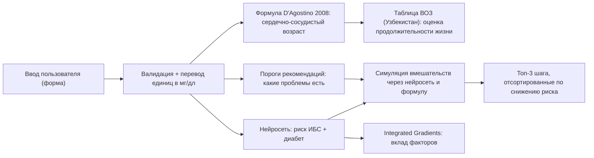

# GEMINI.md — План доведения MedAI Longevity Platform до уровня демонстрации

> **Для кого этот файл:** для ИИ-агента (Gemini), который будет выполнять работу.
> **Цель:** честный, понятный и аккуратный прототип, который можно показать
> Агентству по образованию Узбекистана (школьно-студенческий конкурс социально полезных стартапов).
> **Язык общения с пользователем:** русский, кратко, по шагам.

---

## 0. Как работать с этим файлом (ОБЯЗАТЕЛЬНО прочитать первым)

1. Выполняй фазы **строго по порядку** (Фаза 0 → Фаза 9). Не перескакивай.
2. После каждой фазы:
   - запусти проверки из раздела «Критерии приёмки» этой фазы;
   - допиши запись в `docs/PROGRESS.md` (что сделано, какие команды запускались, их вывод кратко, что не получилось);
   - сделай git-коммит `phase-N: <кратко>`.
3. Если критерий приёмки не выполняется — **не иди дальше**. Исправь или явно запиши в `PROGRESS.md`, почему невозможно.
4. Перед любой работой со Streamlit прочитай навык
   `.agents/skills/developing-with-streamlit/SKILL.md` и указанные в нём references
   (минимум: `design.md`, `layouts.md`, `selection-widgets.md`, `theme.md`, `multipage-apps.md`,
   `dashboards.md`, `code-organization.md`). Сигнатуры проверяй командой `streamlit docs st.<команда>`.
5. Установленные версии (проверено): Python 3.12.10, streamlit 1.61.1, numpy 2.4.6,
   scikit-learn 1.9.0, pandas 2.3.3, plotly 6.9.0. Не используй API, которых нет в этих версиях.
6. Если в процессе возникает развилка с 2+ разумными вариантами и высокой ценой ошибки —
   остановись и спроси пользователя (1–3 вопроса с вариантами). Мелочи решай сам и фиксируй в `PROGRESS.md`.

---

## 1. Что это за проект и зачем

**MedAI Longevity Platform** — веб-приложение (Streamlit) для **скрининга сердечно-сосудистого риска**.
Человек вводит свои базовые показатели (возраст, пол, давление, холестерин, глюкоза, ИМТ, курение…),
и приложение показывает:

1. **Риск ишемической болезни сердца (ИБС) в ближайшие 10 лет** — считает нейросеть,
   обученная на реальных исходах когорты Framingham Heart Study.
2. **Вероятность сахарного диабета (скрининг)** — вторая «голова» той же нейросети.
3. **Сердечно-сосудистый возраст** — по опубликованной формуле D'Agostino et al., *Circulation* 2008.
4. **Оценку ожидаемой продолжительности жизни** — по таблицам смертности ВОЗ **для Узбекистана**
   с поправкой на сердечно-сосудистый возраст (явно помечено как эвристика).
5. **Главные шаги для снижения риска** — пороги из клинических рекомендаций определяют, *есть ли проблема*,
   а нейросеть считает, *насколько* каждый шаг снизит риск, и сортирует шаги по пользе.

**Аудитория демонстрации:** эксперты агентства (в основном не ML-специалисты) + возможно один технический эксперт.
Значит: главный экран — простой и понятный за 5 секунд; техническая глубина — на отдельной странице «Как это работает».

---

## 2. Жёсткие правила честности (нарушать нельзя)

1. **Каждое число на экране** либо вычислено кодом из введённых данных/модели, либо взято из файла
   метрик, созданного скриптом обучения, либо является цитатой с источником. **Никаких захардкоженных метрик,
   графиков loss и «примерных» значений.**
2. **Не выдумывай источники, коды LOINC, статистику, названия API.** Если факт не удалось проверить
   (PubMed/Europe PMC/ВОЗ/официальный сайт) — не пиши его или пометь «не проверено».
3. **Не синтезируй признаки**, которых нет в данных (никаких «max_hr = 208 − 0.7·age», «activity из ИМТ» и т.п.).
4. Эвристики помечай в интерфейсе словом «оценка» и объясняй, как они считаются.
5. Не используй слова «клинически валидировано», «сертифицировано», «диагноз». Используй:
   «исследовательский прототип», «скрининговая оценка», «не заменяет консультацию врача».
6. Порог 0.5 для «высокого риска» **запрещён** (при распространённости ИБС ~15% модель почти никогда не даёт > 0.5).
   Используй категории 10-летнего риска: < 10% низкий, 10–19.9% промежуточный, ≥ 20% высокий
   (категории NCEP ATP III для 10-летнего риска ИБС).
7. Accuracy как главная метрика **запрещена** (несбалансированные классы). Главные метрики: ROC-AUC с 95% ДИ,
   Brier score, калибровка, чувствительность/специфичность при порогах 10% и 20%.

---

## 3. Результаты аудита (проверено запуском кода 2026-10-20)

Скрипт проверки: `C:\Users\Administrator\.gemini\antigravity-ide\brain\4930090f-c6de-4623-8a58-958c59df61ce\scratch\audit_model.py`.

### 3.1 Ответ на вопрос «ИИ берёт данные пациента или делает рандомно?»

- **Риск ИБС — НЕ рандом.** Нейросеть реально получает значения со слайдеров
  (`raw_vec → normalize → nn.predict_with_uncertainty`). Проверка на одном профиле:
  давление 130 → 180 даёт риск 18.4% → 30.2%; курение 18.4% → 24.1%; возраст 48 → 70: 18.4% → 37.2%.
  ROC-AUC на отложенной выборке (848 человек) = **0.736** — это реальная предсказательная способность,
  на уровне логистической регрессии (0.737).
- MC Dropout использует фиксированный `seed=42` → результат детерминирован, не «скачет».
- **НО: «Сосудистый возраст» и «Ожидаемая жизнь» — фактически КОНСТАНТЫ.** Регрессионные головы
  нейросети «схлопнулись»: стандартное отклонение предсказаний 0.012 и 0.004 года (у истинных значений 17.7 и 5.9).
  Для любого человека показывается ≈ 63.95 и ≈ 73.08 лет. Это главный дефект проекта.
- `if/else` в `generate_clinical_analysis()` (app.py) — это правила по клиническим порогам. Сам подход
  нормальный (так работают системы поддержки врачебных решений), **но** функция принимает предсказания
  нейросети (`p_cardiac`, `p_diabetes`, `p_life`, `p_vascular`) и **не использует их**. Связи «ИИ → рекомендации» нет.

### 3.2 Полный список проблем

| # | Серьёзность | Где | Проблема |
|---|---|---|---|
| 1 | КРИТИЧНО | `neural_network.py` `train_step` | Головы `life`/`vascular` не обучаются: регрессионный градиент делится на `m` дважды (`dZ_life = ... / m`, затем `dW = (1/m)·...`), цели не стандартизованы (десятки лет), вес потерь 0.005. Итог — константный выход. |
| 2 | КРИТИЧНО | `dataset_manager.py` `calculate_framingham_vascular_age` | Для женщин взят коэффициент ln(САД) **2.82263** (это коэффициент для *леченого* давления); для нелеченого должно быть **2.76157**. Лечение давления не учитывается вовсе. HDL в эталоне 50/60 вместо 45 мг/дл. Средний разрыв «сосудистый − паспортный» = +15.9 лет, 12% значений упираются в потолок 95 — нереалистично. |
| 3 | КРИТИЧНО | `dataset_manager.py` источник `framingham` | Признаки `max_hr`, `st_dep`, `activity` **выдуманы** формулами из других столбцов (в Framingham их нет). Модель учится на синтетике. |
| 4 | КРИТИЧНО | `dataset_manager.py` `calculate_actuarial_life_expectancy` + `README.md` | Коэффициенты (0.40, 0.15, 3.5, 3.0) придуманы, а README утверждает «Derived from WHO & CDC life tables (Doll 2004; ERFC 2015)» — это неправда. |
| 5 | ВЫСОКО | app.py, вкладка метрик | «Accuracy 85.3% / 98.4%» = доля большинства (84.9% / 97.8%). Только 0.6% пациентов получают риск > 0.5 → метка «ВЫСОКИЙ РИСК» почти никогда не появляется. |
| 6 | ВЫСОКО | app.py | Захардкожены метрики по умолчанию (`em = {...0.8526...}`) и **фальшивая кривая loss** (`[1.538, 1.474, ...]`). |
| 7 | ВЫСОКО | app.py | Кнопка «Дообучить модель» создаётся в самом низу скрипта, а проверка `'run_training_btn' in locals()` стоит выше → обучение никогда не запускается; слайдеры LR/эпох не влияют ни на что. |
| 8 | ВЫСОКО | app.py | Если нет `model_weights.npz`, приложение делает **1 шаг** обучения и сохраняет «необученную» модель. |
| 9 | ВЫСОКО | app.py | Диабет в Framingham — это **статус на момент обследования**, а не 10-летний исход; в тексте/README это подано как прогноз. |
| 10 | СРЕДНЕ | app.py | Блок «Возможные симптомы» (головная боль при АД > 140 и т.п.) — медицински сомнительные утверждения из `if/else`. Удалить. |
| 11 | СРЕДНЕ | app.py | Опечатка «Ожидание I-II ст.» вместо «Ожирение I–II ст.». |
| 12 | СРЕДНЕ | app.py | В рекомендациях внутри HTML виден сырой markdown `**Липиды:**` (звёздочки на экране). |
| 13 | СРЕДНЕ | app.py | Захардкоженный русский текст (плашка сосудистого возраста, «Медицинская валидация», подписи групп, нормы у слайдеров) → в режиме English интерфейс смешанный. Бейдж «Master Your Lifespan» по-английски в RU-режиме. |
| 14 | СРЕДНЕ | app.py | Дизайн: подписи карточек переносятся на 2 строки («КАРДИО-РИСК (CI 95%)»), бейджи «±0.0 (+15.9 к паспортному)» ломаются, вкладка «Точность модели & L…» обрезана, сайдбар почти пустой, ~150 строк кастомного CSS конфликтуют с темой, радиусы 16px/100px противоречат `DESIGN.md` (4–8px), эмодзи в «медицинском» интерфейсе. |
| 15 | СРЕДНЕ | app.py | «CI 95%» по MC Dropout — это не доверительный интервал в статистическом смысле. Для vascular показывает «±0.0». |
| 16 | СРЕДНЕ | app.py | Слайдер возраста 18–95, а данные Framingham — возраст **32–70**. Вне диапазона модель экстраполирует без предупреждения. |
| 17 | СРЕДНЕ | Единицы | Холестерин и глюкоза в мг/дл. В Узбекистане/СНГ лаборатории обычно выдают **ммоль/л** (уверенность ~90%, уточнить у пользователя при сомнении). |
| 18 | СРЕДНЕ | `neural_network.get_feature_attributions` | Базовая точка XAI — нули в нормированном пространстве (= возраст 1 год, АД 50) — бессмысленно; знак вклада теряется (только модуль в %). |
| 19 | СРЕДНЕ | app.py, FHIR | Коды LOINC (`79423-0`, `73696-7`, `75945-9`, `30525-0`) не проверены; часть, вероятно, не соответствует смыслу. |
| 20 | НИЗКО | `requirements.txt` | `numpy<2.0`, а установлена 2.4.6; нет `pandas`; `streamlit>=1.30`, а используются `st.pills`/`st.segmented_control` (нужны новые версии). |
| 21 | НИЗКО | Корень проекта | `PROJECT_AUDIT_REPORT.md` ссылается на старый путь `Neural Network Playground` и содержит слова «фальсификация» — не должен попасть в пакет для агентства. `app.py` — 1150 строк в одном файле. |
| 22 | НИЗКО | `use_container_width` | Устаревший параметр (см. навык Streamlit) — заменить на `width="stretch"`. |

---

## 4. Целевая архитектура (решения и почему)

| Показатель | Чем считается | Почему так |
|---|---|---|
| Риск ИБС за 10 лет | **Нейросеть** (голова 1), метка `TenYearCHD` | Реальный исход наблюдения → это честная задача для ML. |
| Вероятность диабета (скрининг) | **Нейросеть** (голова 2), метка `diabetes` | Реальная метка; сохраняет многозадачность. Подписать как «скрининг текущего состояния», не прогноз. |
| Сердечно-сосудистый возраст | **Формула** D'Agostino 2008 | Это детерминированная опубликованная формула; учить её нейросетью бессмысленно (было MAE ≈ 15 лет). |
| Ожидаемая продолжительность жизни | **Таблица ВОЗ для Узбекистана** + поправка на сердечно-сосудистый возраст | Локальные официальные данные — сильный аргумент для агентства Узбекистана. Явно помечено как оценка. |
| Есть ли проблема (давление высокое?) | **Пороги клинических рекомендаций** (`if/else`, с источником) | Так и должно быть в медицине: пороги задают ВОЗ/ESC/ADA, а не нейросеть. |
| Насколько важен каждый шаг | **Нейросеть** (пересчёт риска после вмешательства) + формула | Связывает правила и ИИ: «бросить курить снизит ваш риск на 5.1 п.п.». |
| Почему такой риск | **Integrated Gradients** от эталонного здорового профиля того же возраста и пола | Знак и величина вклада в процентных пунктах; сумма вкладов ≈ разница рисков. |



---

## 5. Целевая структура файлов

```
MedAI Longevity Platform/
├── streamlit_app.py            # точка входа: st.set_page_config, i18n, st.navigation
├── app_pages/
│   ├── screening.py            # главная: форма → результаты → шаги → вкладки → экспорт
│   ├── methodology.py          # «Как это работает»: данные, модель, метрики, ограничения, источники
│   └── about.py                # «О проекте»: проблема, решение, польза, дорожная карта
├── core/
│   ├── __init__.py
│   ├── config.py               # пути, константы, диапазоны признаков, порядок признаков
│   ├── i18n.py                 # загрузка JSON, функция t(key, **kwargs), проверка ключей
│   ├── units.py                # ммоль/л ⇄ мг/дл
│   ├── clinical.py             # D'Agostino 2008, сердечно-сосудистый возраст, таблица ВОЗ
│   ├── thresholds.py           # категории биомаркеров + источники
│   ├── risk_model.py           # загрузка модели (cache_resource), predict, XAI, симуляции
│   ├── recommendations.py      # правила + интервенции + приоритизация через модель
│   └── report.py               # HTML-отчёт и FHIR Bundle
├── neural_network.py           # переписанная многозадачная сеть (только классификационные головы)
├── scripts/
│   ├── prepare_data.py         # чистка Framingham, сплит, сохранение
│   ├── fetch_who_life_table.py # одноразовая загрузка таблицы ВОЗ → data/
│   └── train_model.py          # обучение, оценка, сохранение весов и metrics.json
├── data/
│   ├── framingham.csv
│   ├── who_life_table_uzb.csv
│   └── README.md               # происхождение данных, лицензия/статус, дата загрузки, sha256
├── models/
│   ├── model_weights.npz
│   ├── metrics.json
│   └── model_card.json
├── i18n/ru.json  i18n/uz.json  i18n/en.json
├── tests/
│   ├── test_clinical.py  test_units.py  test_thresholds.py  test_i18n.py
│   ├── test_neural_network.py  test_risk_model.py  test_recommendations.py
│   └── test_app_smoke.py       # streamlit.testing.v1.AppTest
├── docs/
│   ├── PROGRESS.md  MODEL_CARD.md  LIMITATIONS.md  DEMO_SCRIPT.md
│   └── archive/PROJECT_AUDIT_REPORT.md
├── .streamlit/config.toml
├── DESIGN.md  README.md  requirements.txt  .gitignore
```

Старые `app.py` и `dataset_manager.py` удалить после переноса логики (или перенести в `docs/archive/legacy/`).
Старые тесты `test_neural_network.py` перенести в `tests/` и обновить.

---

## ФАЗА 0 — Подготовка

1. `git status` — убедись, что рабочее дерево чистое; создай ветку `demo-ready`.
2. Сохрани снимок «до»: скриншот текущего UI (через browser subagent, http://localhost:8501) в `docs/screenshots/before.png`.
3. Создай `docs/PROGRESS.md` с заголовком и датой.
4. Прочитай references навыка Streamlit (см. раздел 0, п.4).
5. Обнови `requirements.txt` (закрепи совместимые диапазоны под установленные версии):
   ```
   streamlit>=1.61,<2.0
   numpy>=2.0,<3.0
   pandas>=2.2,<3.0
   scikit-learn>=1.5,<2.0
   altair>=5.0,<6.0
   ```
   (Plotly убрать, если все графики переведены на Altair — см. Фазу 6.) Проверь `pip install -r requirements.txt`.
6. `.gitignore`: `__pycache__/`, `.pytest_cache/`, `*.pyc`, `.streamlit/secrets.toml`.

**Критерии приёмки:** ветка создана; `pip install -r requirements.txt` без ошибок; `pytest` (старые тесты) проходит.

---

## ФАЗА 1 — Данные

### 1.1 Framingham
- Перемести `framingham.csv` в `data/`. Посчитай sha256, запиши в `data/README.md`.
- В `data/README.md` честно опиши происхождение: публичный учебный поднабор данных Framingham Heart Study
  (4 240 участников, 16 столбцов), скачан с GitHub-зеркала
  `https://raw.githubusercontent.com/GauravPadawe/Framingham-Heart-Study/master/framingham.csv`.
  Полные данные исследования выдаются NHLBI BioLINCC по заявке. Население — США, поэтому для Узбекистана
  нужна локальная калибровка (это ограничение, его надо указать).
- Столбцы: `male, age, education, currentSmoker, cigsPerDay, BPMeds, prevalentStroke, prevalentHyp, diabetes,
  totChol, sysBP, diaBP, BMI, heartRate, glucose, TenYearCHD`.
  Пропуски (проверено): education 105, cigsPerDay 29, BPMeds 53, totChol 50, BMI 19, heartRate 1, glucose 388.

### 1.2 Признаки модели (13 входов, порядок фиксирован в `core/config.py`)
`male, age, currentSmoker, cigsPerDay, BPMeds, prevalentStroke, prevalentHyp, totChol, sysBP, diaBP, BMI, heartRate, glucose`

- `education` — **не использовать** (социальный признак, пользователь его не вводит в медицинском скрининге).
- `diabetes` — **не вход**, а цель второй головы.
- Все значения хранить в **мг/дл** (как в данных); перевод единиц только в UI.

### 1.3 Сплит и предобработка (`scripts/prepare_data.py`)
- Стратифицированный по `TenYearCHD` сплит train/val/test = 70/15/15, `random_state=42`.
- Импутация медианой, **посчитанной только на train**. Для `cigsPerDay`: если `currentSmoker==0` → 0.
- Стандартизация (z-score) по статистикам train. Сохранить `mean`, `std`, `medians`, порядок признаков.
- Сохранить индексы сплита (`data/split_indices.npz`), чтобы метрики воспроизводились.

### 1.4 Таблица ВОЗ (`scripts/fetch_who_life_table.py`) — запускается один раз, не из приложения
- API (проверено, работает): `https://ghoapi.azureedge.net/api/LIFE_0000000035?$filter=SpatialDim eq 'UZB'`
  (индикатор «ex — ожидаемая продолжительность оставшейся жизни в возрасте x»).
- Поля: `TimeDim` (год), `Dim1` = `SEX_MLE` / `SEX_FMLE` / `SEX_BTSX`, `Dim2` = `AGEGROUP_YEARS25-29` и т.п., `NumericValue`.
- Взять **последний доступный год** (ожидается 2021 — проверь фактически), только `SEX_MLE` и `SEX_FMLE`.
- Сохранить `data/who_life_table_uzb.csv` со столбцами: `year, sex, age_start, age_end, ex`.
  Обработай группы `AGEGROUP_YEARS00-01`, `01-04`, `85PLUS`/`85+` (проверь реальное написание кода в ответе).
- В `data/README.md`: URL, дата загрузки, год таблицы.

**Критерии приёмки:** `python scripts/prepare_data.py` и `python scripts/fetch_who_life_table.py` отрабатывают;
в CSV ВОЗ есть оба пола и непрерывные возрастные группы; в `data/README.md` всё задокументировано.

---

## ФАЗА 2 — Клинические формулы (`core/clinical.py`, `core/units.py`, `core/thresholds.py`)

### 2.1 Модель D'Agostino 2008 (General CVD, лабораторная версия)

`L = β_age·ln(age) + β_tc·ln(TC) + β_hdl·ln(HDL) + β_sbp·ln(SBP) + β_smk·smoker + β_dm·diabetes`
`Risk10 = 1 − S0 ^ exp(L − L_mean)`; TC, HDL в мг/дл; SBP в мм рт. ст.

| Коэффициент | Мужчины | Женщины |
|---|---|---|
| ln(возраст) | 3.06117 | 2.32888 |
| ln(общий холестерин) | 1.12370 | 1.20904 |
| ln(HDL) | −0.93263 | −0.70833 |
| ln(САД), без лечения | 1.93303 | 2.76157 |
| ln(САД), на лечении | 1.99881 | 2.82263 |
| Курение | 0.65451 | 0.52873 |
| Диабет | 0.57367 | 0.69154 |
| S0(10) | 0.88936 | 0.95012 |
| Среднее L | 23.9388 | 26.1931 |

> Перед кодированием **сверь таблицу с первоисточником** (D'Agostino RB Sr et al. *Circulation* 2008;117:743–753,
> PMID 18212285) через навык `pubmed-database` или `literature-search-europepmc`. Результат сверки запиши в `PROGRESS.md`.
> Если полный текст недоступен — пометь «сверено по вторичным источникам».

### 2.2 Сердечно-сосудистый («сердечный») возраст
- Эталонный профиль того же пола: САД 125 без лечения, общий холестерин 180 мг/дл, HDL 45 мг/дл, не курит, нет диабета
  (уверенность ~80% — сверить с первоисточником вместе с п.2.1).
- Поскольку эталон отличается от пациента только не-возрастными членами, решение в замкнутой форме:
  `heart_age = exp( (L_patient − C_ref) / β_age )`, где `C_ref` — сумма не-возрастных членов эталона.
  Это эквивалентно поиску возраста эталона с тем же риском (риск монотонен по L).
- Входы формулы из UI: возраст, пол, САД, общий холестерин, **HDL** (новое поле, по умолчанию 45 мг/дл = 1.16 ммоль/л
  с подсказкой «если не знаете — оставьте по умолчанию»), курение, диабет (= переключатель «диабет диагностирован»
  ИЛИ глюкоза натощак ≥ 126 мг/дл), лечение давления (= `BPMeds`).
- Формула валидирована для возраста 30–74. Отображение: ограничить 30…80; если > 80 — показывать «> 80».
- Возвращать также `risk10_general_cvd` (для страницы методологии как сравнение).

### 2.3 Ожидаемая продолжительность жизни (оценка)
- `ex(age, sex)` — линейная интерполяция по таблице ВОЗ (точка = начало возрастной группы).
- `life_estimate = age + ex(heart_age, sex)`; `life_baseline = age + ex(age, sex)`; `delta = life_estimate − life_baseline`.
- В UI подпись: «Оценка по таблицам смертности ВОЗ для Узбекистана (год N) с поправкой на сердечно-сосудистый возраст.
  Это ориентир для мотивации, а не медицинский прогноз».

### 2.4 Единицы (`core/units.py`)
- Холестерин: 1 ммоль/л = 38.67 мг/дл. Глюкоза: 1 ммоль/л = 18.016 мг/дл.
- Функции `to_mgdl(value, analyte, unit)`, `from_mgdl(...)`. Округление в UI: ммоль/л — 1 знак, мг/дл — целые.

### 2.5 Пороги (`core/thresholds.py`) — каждый с источником
| Биомаркер | Категории | Источник |
|---|---|---|
| САД/ДАД | < 120/80 оптимальное; 120–129/80–84 нормальное; 130–139/85–89 высокое нормальное; ≥ 140/90 гипертензия | ESC/ESH 2018; ВОЗ 2021 (гипертензия ≥ 140/90) |
| Общий холестерин | < 200 мг/дл (< 5.2 ммоль/л) желательный; 200–239 погранично высокий; ≥ 240 (≥ 6.2) высокий | NCEP ATP III |
| HDL | < 40 мг/дл (муж.) / < 50 (жен.) — низкий | NCEP ATP III |
| Глюкоза натощак | < 110 мг/дл (< 6.1 ммоль/л) норма; 110–125 (6.1–6.9) нарушенная гликемия натощак; ≥ 126 (≥ 7.0) — подозрение на диабет | ВОЗ (ADA использует нижнюю границу 100) |
| ИМТ | < 18.5 дефицит; 18.5–24.9 норма; 25–29.9 избыточный вес; ≥ 30 ожирение | ВОЗ |
| Пульс покоя | 60–100 уд/мин норма | общепринятая клиническая норма |
| Курение | любое курение — фактор риска | ВОЗ |

Функция `classify(marker, value, sex) -> {"level": "ok|warn|high", "label_key": ..., "source": ...}`.

### 2.6 Тесты (`tests/test_clinical.py`, `test_units.py`, `test_thresholds.py`)
- Пациент с эталонными значениями → `heart_age == age` (±0.01).
- Монотонность: рост САД/холестерина/курение/диабет → heart_age растёт; рост HDL → падает.
- Женщины: при `BPMeds=0` используется 2.76157 (тест на конкретное значение L).
- Риск D'Agostino в диапазоне (0, 1); растёт с возрастом.
- Интерполяция ВОЗ: значение на границе группы совпадает с таблицей; монотонно убывает с возрастом.
- Единицы: round-trip ммоль/л → мг/дл → ммоль/л с точностью 1e-9.
- Пороги: граничные значения (119/120, 139/140, 125/126 и т.п.) попадают в правильные категории.

**Критерии приёмки:** все тесты проходят; на 4 тестовых профилях (молодой здоровый, курильщик с гипертензией,
женщина на лечении АД, пожилой диабетик) значения выглядят правдоподобно; средний разрыв heart_age − age
по всей выборке Framingham (при HDL = 45) записан в `PROGRESS.md` и обсуждён (ожидается заметно меньше +15.9).

---

## ФАЗА 3 — Нейросеть и обучение

### 3.1 Переписать `neural_network.py`
- Класс `MultiTaskNeuralNetwork(input_dim, hidden_sizes, heads=("chd","diabetes"), dropout=0.1, l2=1e-4, lr=0.005, seed=42)`.
- Только **классификационные** головы (sigmoid + BCE). Регрессионные головы удалить.
- Корректный backprop: для BCE+sigmoid `dZ = (p − y)`, `dW = (1/m)·Aᵀ·dZ` — деление на m **один раз**.
- Dropout только при обучении; инференс детерминированный.
- Свой `numpy.random.Generator` в объекте (не глобальный `np.random`).
- Мини-батчи (256), Adam, клиппинг градиента.
- Метод `input_gradient(x, head)` — аналитический градиент выхода по входу (обратный проход до входа),
  нужен для Integrated Gradients. Проверить против конечных разностей в тесте (отн. ошибка < 1e-4).
- `save(path, metadata)` / `load(path)`: сохранить веса, архитектуру, **порядок признаков, mean/std/medians**,
  версию формата, дату обучения. `allow_pickle=False`. Буферы Adam не сохранять.

### 3.2 `scripts/train_model.py`
1. Загрузить подготовленные данные и сплит.
2. Обучить сеть [13 → 32 → 16 → 2 головы], swish, early stopping по val-loss (patience 100, max 3000 эпох).
   Запиши фактическую лучшую эпоху.
3. Бейзлайн: `sklearn.linear_model.LogisticRegression` на тех же признаках/сплите (для каждой головы).
4. Сравнение: формула D'Agostino (risk10) на test — **только как ориентир** (другой исход: общий ССЗ vs ИБС; нет HDL в данных → HDL=45).
5. Метрики на **test** для каждой головы и каждой модели:
   - ROC-AUC + 95% ДИ бутстрепом (1000 повторов, seed 42);
   - Brier score; калибровка: 10 бинов (средний прогноз vs доля событий) — сохранить точки;
   - для ИБС: чувствительность, специфичность, PPV при порогах 0.10 и 0.20;
   - распространённость класса в test.
6. Кривая обучения: train/val loss по эпохам → в `metrics.json` (это **реальная** кривая, её покажет UI).
7. Сохранить `models/model_weights.npz`, `models/metrics.json`, `models/model_card.json`
   (sha256 данных, версии библиотек, гиперпараметры, дата).

**Ожидания (для самопроверки, не для подгонки):** AUC ИБС ≈ 0.72–0.75 (на текущих данных LR даёт 0.73–0.74).
Если AUC сети < AUC LR − 0.02 — проверь обучение. Если сеть не лучше LR — **так и напиши** на странице методологии
(«нейросеть сопоставима с логистической регрессией»). Не подгоняй сплит/seed под красивую цифру.

### 3.3 `core/risk_model.py`
- `@st.cache_resource load_model()`; если файла нет — `st.error` с инструкцией `python scripts/train_model.py` и `st.stop()`.
  **Никакого обучения при запуске приложения.**
- `predict(patient: dict) -> {"chd": float, "diabetes": float}` (вход в мг/дл, внутри импутация/стандартизация).
- `explain(patient, head="chd")` — Integrated Gradients (50 шагов) от эталона: тот же возраст и пол,
  САД 120, ДАД 80, ХС 180, ИМТ 22, глюкоза 90, пульс 70, не курит, cigsPerDay 0, без лечения АД, без инсульта,
  без гипертензии. Вернуть вклад каждого признака в **процентных пунктах** со знаком.
  Проверка полноты: `sum(contrib) ≈ p(patient) − p(reference)` (допуск 0.5 п.п.) — тест.
- `simulate(patient, changes: dict)` → новые `chd`, `diabetes`, `heart_age`, `life_estimate`.
- `trajectory(patient, years=(0,5,10,15,20), improved=False)` → по годам: возраст+t, риск ИБС, heart_age.
  Флаг `extrapolated=True` для возраста > 70 (за пределами обучающих данных).

### 3.4 Тесты
- Формы выходов, вероятности в [0,1], детерминизм инференса.
- Градиент: аналитический vs конечные разности.
- Сохранение/загрузка дают идентичные предсказания.
- Санити-монотонность на среднем профиле: САД 120 → 180 повышает риск ИБС; курение повышает риск.
- `metrics.json` существует и содержит AUC для обеих голов и обеих моделей.

**Критерии приёмки:** обучение воспроизводимо (два запуска → одинаковые метрики); в приложении нет обучения;
`pytest` зелёный; метрики записаны в `PROGRESS.md`.

---

## ФАЗА 4 — Рекомендации, связанные с ИИ (`core/recommendations.py`)

1. Правило = `{id, condition(patient)->bool, intervention(patient)->dict изменений, title_key, why_key, source}`.
   Список правил:
   - курение → `currentSmoker=0, cigsPerDay=0`;
   - САД ≥ 130 → `sysBP=120, diaBP=80` (у пациентов на лечении — «обсудить с врачом коррекцию терапии»);
   - ХС ≥ 200 мг/дл → `totChol=180`;
   - ИМТ ≥ 25 → `BMI=max(24.9, BMI−0.1·BMI)` (реалистичное снижение веса ~10%);
   - глюкоза ≥ 110 мг/дл → `glucose=99` + совет обратиться к эндокринологу, анализ HbA1c;
   - HDL низкий → совет про физическую активность (без интервенции в модель: HDL не вход сети).
2. Для каждого сработавшего правила посчитать через `simulate`: Δриск ИБС (п.п.), Δheart_age (лет), Δоценки жизни.
3. Сортировать по Δриск ИБС (по убыванию снижения). Показать **топ-3** на главном экране, остальные — в раскрывающемся списке.
4. Если ни одно правило не сработало — позитивное сообщение «показатели в целевых диапазонах» + общий совет ВОЗ
   (≥ 150 минут умеренной активности в неделю).
5. Тексты рекомендаций — без чисел, которые нельзя проверить. Цифру «отказ от курения добавляет N лет жизни»
   использовать **только** если сверена с первоисточником (Doll R. et al., BMJ 2004, doi:10.1136/bmj.38142.554479.AE);
   иначе — без числа.
6. Блок «Возможные симптомы» **удалить** полностью.

**Тесты:** условия на граничных значениях; приоритизация (курильщик с АД 180 → первым идёт действие с бо́льшим Δ);
здоровый профиль → нет действий.

**Критерии приёмки:** рекомендации на 4 тестовых профилях выглядят разумно; у каждой есть источник и число Δ из модели.

---

## ФАЗА 5 — Интернационализация и единицы

1. Все пользовательские строки — только в `i18n/ru.json`, `i18n/uz.json`, `i18n/en.json`. В `.py` нет кириллицы/английского текста интерфейса
   (проверка: `grep` по `[А-Яа-яЁё]` в `core/` и `app_pages/` → пусто, кроме комментариев).
2. Узбекский — **латиница** (официальная письменность). В README и на странице «О проекте»:
   «перевод на узбекский выполнен с помощью ИИ и требует проверки носителем языка».
3. `t(key, **kwargs)` с подстановкой; при отсутствии ключа — исключение в тестах, fallback на ru в продакшене.
4. Тест `test_i18n.py`: множества ключей во всех трёх файлах совпадают; нет пустых строк; все `{placeholder}` совпадают.
5. Единицы: переключатель «ммоль/л | мг/дл» (по умолчанию **ммоль/л**), хранится в `st.session_state`.
   Нормы в подсказках выводятся в выбранных единицах.
6. Язык по умолчанию — русский. Переключатель языка — в шапке (`st.segmented_control`: «Русский | O'zbekcha | English»).

**Критерии приёмки:** переключение языка меняет **всё** (включая графики, отчёт, ошибки); тест i18n зелёный.

---

## ФАЗА 6 — Дизайн и UI (главная работа по «кривому» виду)

### 6.1 Принципы
- Следовать `DESIGN.md` (токены цветов, Inter + JetBrains Mono для чисел, радиусы 4–8px, без неона/свечения).
- Следовать навыку Streamlit: **нативные элементы** вместо HTML (`st.metric(border=True)`, `st.container(border=True)`,
  `st.badge`, `st.segmented_control`, `st.toggle`, `st.number_input`, `st.form`), иконки `:material/...:` вместо эмодзи,
  sentence case (без КАПСА в подписях), без `use_container_width`.
- Кастомный CSS — **удалить** весь блок `<style>` (~150 строк). Внешний вид — через `.streamlit/config.toml`
  (см. `references/theme.md`; проверь поддерживаемые ключи: `primaryColor`, `backgroundColor`,
  `secondaryBackgroundColor`, `textColor`, `font`, `baseRadius`, `borderColor`, `showWidgetBorder` и т.д.
  командой `streamlit config show`). Допустимо ≤ 20 строк CSS, только если без этого нельзя, с комментарием «зачем».
- Графики — Altair (рекомендация навыка), единая палитра: низкий риск `#10b981`, промежуточный `#d97706`, высокий `#ba1a1a`,
  основной `#006c49`, вторичный `#0051d5`.
- Проверка на разрешениях **1366×768**, **1536×730** (текущий ноутбук пользователя), **1920×1080** и проектор **1280×720**:
  ни одна подпись карточки не переносится на 2 строки, нет обрезанных вкладок, нет горизонтального скролла.

### 6.2 Навигация (`streamlit_app.py`)
- `st.set_page_config(page_title=t("app.title"), page_icon=":material/cardiology:", layout="wide")` (проверь имя иконки).
- `st.navigation([...], position="top")` — проверь параметр через `streamlit docs st.navigation`. Сайдбар не использовать.
- Страницы: «Скрининг» (`:material/monitor_heart:`), «Как это работает» (`:material/science:`), «О проекте» (`:material/info:`).
- В шапке справа: язык и единицы.

### 6.3 Главная страница «Скрининг» — макет

```
┌───────────────────────────────────────────────────────────────────────────────┐
│ MedAI Longevity · Скрининг сердечно-сосудистого риска    [RU|UZ|EN] [ммоль/л|мг/дл] │
│ Исследовательский прототип. Не заменяет консультацию врача.                    │
├──────────────────────────┬────────────────────────────────────────────────────┤
│ ФОРМА (st.form)          │ РЕЗУЛЬТАТЫ (появляются после «Рассчитать»)          │
│ О вас                    │ ┌────────┐┌────────┐┌────────┐┌────────┐            │
│  Возраст [слайдер 32–70] │ │Риск ИБС││Возраст ││Оценка  ││Риск    │            │
│  Пол [Муж | Жен]         │ │10 лет  ││сосудов ││жизни   ││диабета │            │
│  Рост, вес → ИМТ авто    │ │ 18.4 % ││ 56 лет ││ 74 г.  ││ 3.1 %  │            │
│ Давление                 │ │Промеж. ││+8 лет  ││−3 г.   ││Низкий  │            │
│  САД, ДАД [number_input] │ └────────┘└────────┘└────────┘└────────┘            │
│  Лечение АД [toggle]     │ [Вердикт: 1–2 простых предложения, st.warning/...]  │
│  Гипертензия диагн.[tgl] │                                                    │
│ Анализы крови            │ Ваши главные шаги                                  │
│  Общий ХС, HDL, глюкоза  │  1. Бросить курить     риск −5.1 п.п. · сосуды −6 л │
│ Образ жизни и анамнез    │  2. Снизить САД до 120 риск −3.4 п.п. · сосуды −4 л │
│  Курение [toggle]        │  3. Снизить ХС до 4.7  риск −1.2 п.п. · сосуды −2 л │
│  Сигарет в день (если да)│                                                    │
│  Пульс покоя             │ [Вкладки: Что, если? | Факторы риска | Показатели | │
│  Инсульт в анамнезе[tgl] │           Прогноз на 20 лет]                        │
│  Диабет диагностир.[tgl] │                                                    │
│ [ Рассчитать риск ]      │ [Скачать отчёт (HTML)] [Экспорт FHIR (JSON)]        │
└──────────────────────────┴────────────────────────────────────────────────────┘
```

Детали:
- Колонки `st.columns([1, 2], gap="large")`.
- **Форма с кнопкой «Рассчитать риск»** (`st.form`) — пользователь видит причинно-следственную связь
  «ввёл данные → ИИ посчитал» (это прямой ответ на сомнение «а не рандом ли это?»). Результаты храни в `st.session_state`.
  До первого расчёта — заглушка с пояснением «Введите показатели и нажмите “Рассчитать риск”».
- Лабораторные значения — `st.number_input` (точный ввод, как в бланке анализа) с `min/max/step` и `help` с нормой
  в выбранных единицах. Диапазоны ввода — по 1–99 перцентилям Framingham (проверено):
  САД 97–200, ДАД 60–118, ХС 153–354 мг/дл, ИМТ 18.2–39, глюкоза 55–175 мг/дл, пульс 52–110, сигарет 0–43.
  Разрешить ввод чуть шире (физиологичные пределы), но при выходе за 1–99 перцентиль показывать `st.caption`
  «значение вне типичного диапазона обучающих данных — точность ниже».
- Возраст: слайдер 32–70 (диапазон данных). Если пользователю нужно другое — не давать; в подсказке объяснить почему.
- ИМТ: вычислять из роста и веса (понятнее людям), показывать рассчитанное значение.
- `cigsPerDay` показывать только при включённом курении.
- 4 карточки — `st.metric(label, value, delta, delta_color, border=True, help=...)`. Подписи **короткие**
  (≤ 18 символов), чтобы не переносились. Категорию риска — `st.badge` под значением или в `delta`.
  - Риск ИБС: значение `xx.x %`, категория по порогам 10/20%.
  - Возраст сосудов: `NN лет`, delta = heart_age − age, `delta_color="inverse"` (рост — красный).
  - Оценка жизни: `NN лет`, delta = vs средний по Узбекистану для этого возраста и пола; help с пояснением эвристики.
  - Риск диабета: `x.x %`, подпись «скрининг» в help.
- Вердикт — шаблон из i18n с подстановкой (категория риска, разрыв возраста, главный фактор из XAI).
- Топ-3 шага — `st.container(border=True)` на шаг: иконка, название, `Δ` риска и возраста сосудов, ссылка «Источник».

### 6.4 Вкладки
1. **«Что, если?»** — `st.pills(selection_mode="multi")` с доступными вмешательствами (только применимые к пациенту).
   Под ними 4 метрики «до → после» (`st.metric` с delta). Пересчёт — сразу при выборе (вне формы).
2. **«Факторы риска»** — горизонтальная столбчатая диаграмма Altair: вклад в п.п. со знаком
   (красный — повышает, зелёный — понижает), подпись «по сравнению со здоровым человеком вашего возраста и пола».
   Возраст и пол в эталоне такие же → их вклад 0, не показывать.
3. **«Показатели»** — `st.dataframe` с `column_config`: показатель, ваше значение (в выбранных единицах), норма, статус
   (значок/цветной текст), источник нормы. **Радар-диаграмму удалить** (произвольная нормировка, плохо читается).
4. **«Прогноз на 20 лет»** — линии риска ИБС «сейчас» и «после всех шагов» по возрасту; область возраста > 70
   заштрихована/серая с подписью «за пределами данных обучения». Под графиком: «Расчёт при условии, что
   показатели не изменятся; учитывается только старение».

### 6.5 Страница «Как это работает»
- Схема пайплайна (Mermaid из раздела 4 или `st.graphviz_chart`), простым языком: что делает нейросеть, что формула, что правила.
- Данные: карточка датасета (n=4 240, распространённость ИБС, возраст 32–70, источник, ограничения).
- Модель: архитектура (13 → 32 → 16 → 2), обучение (early stopping, эпоха), **реальная** кривая loss из `metrics.json`.
- Качество: таблица AUC [95% ДИ], Brier для NN / LogReg / D'Agostino; ROC-кривая; калибровочный график;
  чувствительность/специфичность при 10% и 20%. Всё читается из `metrics.json`. Простое объяснение AUC одной фразой.
- Ограничения (`docs/LIMITATIONS.md` → вывести): данные США; учебный поднабор; не валидировано на населении Узбекистана;
  диабет — текущий статус; оценка жизни — эвристика; не медицинское изделие.
- Источники: список с DOI/ссылками (только проверенные).

### 6.6 Страница «О проекте»
- Проблема: роль сердечно-сосудистых заболеваний в смертности в Узбекистане — **только с проверенной цифрой и ссылкой на ВОЗ**
  (например, WHO NCD Country Profile / GHO). Если не удалось проверить — сформулировать без цифр.
- Решение и для кого: участковые терапевты/семейные врачи, школы здоровья, корпоративные чекапы, сам пользователь.
- Почему полезно: быстро, бесплатно, на родном языке, объясняет «почему» и «что делать».
- Дорожная карта: валидация на обезличенных данных поликлиник Узбекистана → перекалибровка → пилот → интеграция
  с медицинскими информационными системами (без названий конкретных систем, если не проверены).
- Автор/команда (оставить плейсхолдер для заполнения пользователем, явно помеченный `TODO`).

### 6.7 `.streamlit/config.toml`
Перенести токены из `DESIGN.md`: primary `#006c49`, фон `#f4fbf4`, вторичный фон `#ffffff`, текст `#161d19`,
шрифт Inter (как подключать Google Font в 1.61 — смотри `references/theme.md`), моно-шрифт JetBrains Mono для чисел,
`baseRadius` ≈ 0.5rem. Убедиться, что светлая тема выглядит одинаково на всех страницах.

**Критерии приёмки Фазы 6:** скриншоты всех 3 страниц в 3 языках на 1366×768 и 1920×1080 в `docs/screenshots/`;
нет переносов подписей карточек, обрезанных вкладок, сырого markdown, смешения языков; блок `<style>` удалён
или ≤ 20 строк с обоснованием; `grep use_container_width` → пусто.

---

## ФАЗА 7 — Отчёты (`core/report.py`)

1. **HTML-отчёт** (1–2 страницы A4, печать через `window.print()` не нужна — просто аккуратный HTML с `@media print`):
   дата, введённые показатели (в выбранных единицах), 4 результата с категориями, топ-3 шага, вклад факторов (таблица),
   методология 3 строками, ограничения, дисклеймер. Язык — текущий. Без внешних шрифтов/скриптов (офлайн-печать).
2. **FHIR R4 Bundle** (`type: "collection"`): `DiagnosticReport` + `Observation` на каждый результат,
   `DiagnosticReport.result` — ссылки `Reference(Observation)`.
   - Коды LOINC использовать **только проверенные** на https://loinc.org (поиск по коду). Каждый код сверить:
     совпадает ли смысл. Если подходящего проверенного кода нет — использовать локальную систему
     `"system": "urn:medai:codes"` с понятным `code`/`display`. Записать результат проверки в `PROGRESS.md`.
   - Не использовать несуществующий extension `observation-confidenceInterval`; неопределённость не экспортировать
     (или через стандартный `Observation.referenceRange`/`note` — на усмотрение, с обоснованием).
3. Тесты: HTML содержит все 4 результата и дисклеймер на каждом языке; FHIR — валидный JSON, `resourceType` корректны,
   ссылки `Observation/<id>` указывают на существующие ресурсы.

**Критерии приёмки:** оба файла скачиваются из UI; HTML открывается в браузере и печатается на A4 без обрезки.

---

## ФАЗА 8 — Тестирование и QA

1. `pytest -q` — всё зелёное. Ожидаемый набор: `test_clinical`, `test_units`, `test_thresholds`, `test_i18n`,
   `test_neural_network`, `test_risk_model`, `test_recommendations`, `test_report`, `test_app_smoke`.
2. `tests/test_app_smoke.py` на `streamlit.testing.v1.AppTest`: приложение запускается без исключений на каждой странице;
   заполнение формы и нажатие «Рассчитать риск» даёт 4 метрики; переключение языка не падает.
   (Сигнатуры проверить через `streamlit docs`.)
3. Ручная проверка через browser subagent на http://localhost:8501 (перезапусти `streamlit run streamlit_app.py`):
   - 4 тестовых профиля → значения правдоподобны, всё меняется при изменении ввода (особенно возраст сосудов и оценка жизни!);
   - крайние значения ввода, пустые/нулевые значения, переключение единиц туда-обратно не меняет результат;
   - все 3 языка, все 3 страницы, оба экспорта;
   - разрешения из Фазы 6.
4. Время пересчёта после нажатия кнопки < 1 с на ноутбуке (замерить, записать).
5. Найденные дефекты — исправить и повторить проверку. Записать в `PROGRESS.md`.

**4 тестовых профиля** (значения в мг/дл):
| Профиль | Пол | Возраст | САД/ДАД | Лечение АД | ХС | HDL | Глюкоза | ИМТ | Курение | Диабет |
|---|---|---|---|---|---|---|---|---|---|---|
| A здоровый | Ж | 35 | 115/75 | нет | 170 | 60 | 85 | 22 | нет | нет |
| B курильщик | М | 52 | 150/95 | нет | 250 | 38 | 105 | 29 | да, 20/день | нет |
| C на лечении | Ж | 60 | 135/85 | да | 220 | 50 | 100 | 27 | нет | нет |
| D диабетик | М | 66 | 160/90 | да | 260 | 35 | 160 | 32 | да, 10/день | да |

Ожидаемый порядок риска ИБС: A < C < B < D (проверить; если не так — разобраться).

---

## ФАЗА 9 — Документация и пакет для агентства

1. **README.md** (RU основной + краткий EN-раздел): что это, для кого, скриншот, как запустить
   (`pip install -r requirements.txt` → `python scripts/train_model.py` (если нет весов) → `streamlit run streamlit_app.py`),
   как устроено (таблица из раздела 4), реальные метрики из `metrics.json`, ограничения, источники, дисклеймер.
   Убрать все неподтверждённые утверждения (в т.ч. про «WHO & CDC life tables / Doll / ERFC» для старой формулы).
2. **docs/MODEL_CARD.md** — назначение, данные, признаки, обучение, метрики с ДИ, калибровка, ограничения, этика.
3. **docs/LIMITATIONS.md** — честный список ограничений (см. 6.5).
4. **docs/DEMO_SCRIPT.md** — сценарий показа на 5 минут:
   1) проблема (30 с) → 2) ввод профиля B (60 с) → 3) результаты и вердикт (45 с) → 4) топ-3 шага и «Что, если?» —
   отказ от курения (60 с) → 5) «Как это работает»: данные, AUC, честное сравнение с LogReg (60 с) →
   6) ограничения и план пилота (45 с). Плюс ответы на 6 ожидаемых вопросов жюри
   («это нейросеть или if/else?», «на каких данных?», «почему данные США?», «насколько точно?», «что дальше?», «кто будет пользоваться?»).
5. Переместить `PROJECT_AUDIT_REPORT.md` в `docs/archive/`. Удалить `app.py`, `dataset_manager.py` после переноса
   (или в `docs/archive/legacy/`). Убедиться, что `streamlit run streamlit_app.py` — единственная точка входа.
6. После завершения всех фаз переименовать этот файл в `docs/IMPLEMENTATION_PLAN.md`
   (иначе он будет постоянно подгружаться в контекст агента как правило).

---

## Definition of Done (финальный чек-лист — всё должно быть «да»)

- [ ] Возраст сосудов и оценка жизни **меняются** при изменении ввода (проверено на 4 профилях).
- [ ] Нейросеть обучена скриптом; в приложении нет обучения; веса + метрики + карточка модели в `models/`.
- [ ] На экране нет ни одного захардкоженного числа метрик/loss; всё из `metrics.json`.
- [ ] Нет синтетических признаков; входы — реальные столбцы Framingham (+ HDL только для формулы).
- [ ] Коэффициенты D'Agostino сверены (результат сверки в `PROGRESS.md`); женщины без лечения — 2.76157.
- [ ] Категории риска 10/20%, не 0.5. Главная метрика — AUC с 95% ДИ, есть калибровка и сравнение с LogReg.
- [ ] Рекомендации отсортированы по Δриска, посчитанной моделью; у каждой — источник; блок «симптомы» удалён.
- [ ] RU / UZ / EN полностью; ни одной строки интерфейса в `.py`; тест i18n зелёный.
- [ ] ммоль/л по умолчанию, переключение единиц не меняет результат.
- [ ] UI на нативных компонентах, без переносов/обрезаний на 1366×768 и 1920×1080; скриншоты в `docs/screenshots/`.
- [ ] HTML-отчёт и FHIR (с проверенными кодами или локальной системой) скачиваются и корректны.
- [ ] `pytest -q` зелёный, включая AppTest smoke.
- [ ] README, MODEL_CARD, LIMITATIONS, DEMO_SCRIPT написаны; нет неподтверждённых утверждений.
- [ ] Дисклеймер «исследовательский прототип, не заменяет врача» виден на главной странице и в отчёте.
- [ ] Этот файл перенесён в `docs/IMPLEMENTATION_PLAN.md`.

---

## Чего НЕ делать

- Не обучать модель при запуске приложения и не давать пользователю кнопку обучения в демо-интерфейсе.
- Не возвращать 3D PCA, радар, «консоль инженера» на главную страницу.
- Не использовать порог 0.5 и accuracy как главную метрику.
- Не придумывать признаки, коэффициенты, коды LOINC, статистику, источники.
- Не вызывать внешние API во время работы приложения (ВОЗ — только скриптом, заранее).
- Не оставлять смешение языков и сырой markdown внутри HTML.
- Не использовать `use_container_width`, `st.components.v1.html`, большие блоки кастомного CSS.
- Не удалять и не ослаблять тесты, чтобы они «прошли».
- Не писать «клинически валидировано», «сертифицировано», «ставит диагноз».
