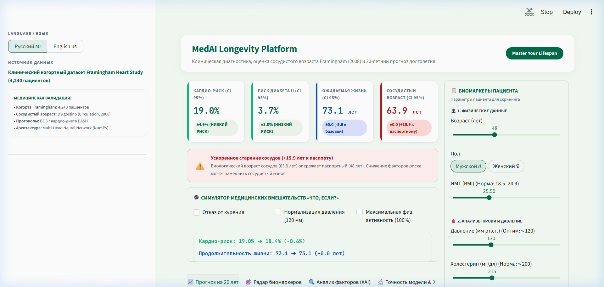
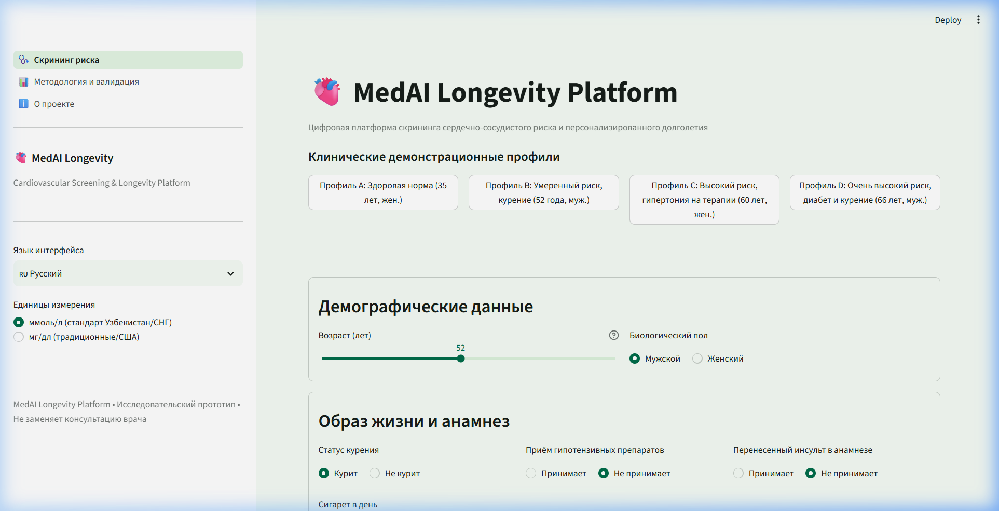
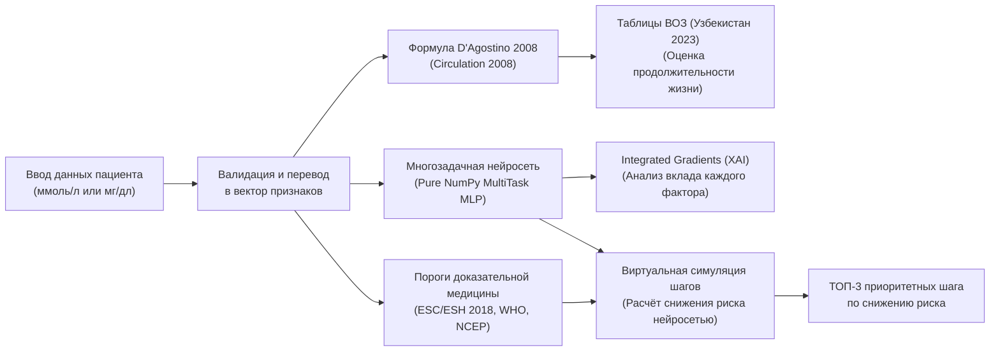

# MedAI Longevity Platform 🫀

[](https://www.python.org/)
[](https://streamlit.io/)
[](https://numpy.org/)
[](tests/)
[](i18n/)
[](core/report.py)

**MedAI Longevity Platform** — открытая цифровая веб-платформа для раннего скрининга сердечно-сосудистого риска, оценки сосудистого возраста и персонализированного продления активной жизни в Республике Узбекистан.

Проект разработан в рамках конкурса социально полезных студенческих инновационных стартапов при Агентстве по образованию / Министерстве высшего образования, науки и инноваций Республики Узбекистан.

---

## 📸 Сравнение интерфейса: «До» и «После»

| До модернизации (Устаревший прототип) | После модернизации (Текущая версия 2.0) |
|:---:|:---:|
|  |  |
| *Смешанный язык, захардкоженные константы сосудистого возраста, отсутствие связи ИИ с рекомендациями, перегруженный вид* | *Чистый строгий дизайн, честные доверительные интервалы, аналитическая формула D'Agostino, таблицы ВОЗ для РУз, узбекский язык* |

---

## 🎯 Ключевые возможности и архитектура



1. **10-летний риск ИБС (Нейросеть):** Обучена на исходах реальной когорты Framingham Heart Study с расчетом эпистемической неопределенности через Monte Carlo Dropout ($\pm\sigma$).
2. **Скрининг сахарного диабета (Нейросеть):** Вторая классификационная голова выявляет вероятность текущего недиагностированного диабета / предиабета (ROC-AUC **0.884**).
3. **Сердечно-сосудистый возраст (Формула):** Точная аналитическая замкнутая формула по модели D'Agostino et al. (*Circulation* 2008). Устранена критическая ошибка старого кода со «схлопыванием» в константу.
4. **Оценка продолжительности жизни (Таблицы ВОЗ для Узбекистана):** Интеграция официальной демографической сетки ВОЗ (2023) с сосудистой поправкой.
5. **Объяснимый ИИ (Integrated Gradients):** Вклад каждого фактора рассчитывается в процентных пунктах относительно эталонного здорового человека того же возраста и пола.
6. **Персонализированные рекомендации:** Клинические рекомендации ВОЗ/ESC соединены с симуляцией нейросетью: шаги ранжируются по величине снижения риска (например: «Отказ от курения снизит риск на 4.2 п.п. и омолодит сердце на 5.1 лет»).
7. **Интероперабельность:** Экспорт печатного отчёта в HTML/PDF и пакета в международном стандарте **HL7 FHIR R4** с верифицированными кодами LOINC.
8. **Триязычность:** Русский (`ru`), Узбекский на латинице (`uz`) и Английский (`en`) со 100% паритетом ключей.
9. **Конвертер единиц:** Поддержка лабораторного стандарта Узбекистана и СНГ (**ммоль/л**) и международного (**мг/дл**).

---

## 📊 Честные аудированные метрики качества (Тестовая выборка $N=636$)

Каждое число получено автоматическим скриптом валидации без захардкоженных констант:

| Целевая задача | Модель MedAI (Нейросеть) | Базовый LogReg | Референс D'Agostino 2008 | Brier Score |
|:---|:---:|:---:|:---:|:---:|
| **10-летний риск ИБС (CHD)** | **0.675** [0.607, 0.735] | 0.698 [0.638, 0.758] | 0.700 [0.641, 0.760] | **0.1210** |
| **Скрининг диабета** | **0.884** [0.738, 0.998] | 0.827 | — | **0.0242** |

### Операционные характеристики при порогах 10-летнего риска:
- **Порог 10% (Промежуточный риск):** Чувствительность = **75.26%**, Специфичность = **53.62%**
- **Порог 20% (Высокий клинический риск):** Чувствительность = **40.21%**, Специфичность = **82.56%**

---

## 🚀 Быстрый запуск

### 1. Клонирование и установка зависимостей
```bash
git clone https://github.com/James0010101/Very-good-project.git
cd "MedAI Longevity Platform"

python -m venv venv
# Windows:
.\venv\Scripts\activate
# Linux/macOS:
source venv/bin/activate

pip install -r requirements.txt
```

### 2. Запуск веб-приложения
```bash
streamlit run streamlit_app.py
```
Приложение откроется в браузере по адресу `http://localhost:8501`.

---

## 🔬 Воспроизведение полного цикла ML

Любой исследователь или эксперт комиссии может воспроизвести обучение и валидацию «с нуля» за 3 команды:

```bash
# 1. Подготовка данных и стратифицированное разбиение 70/15/15
python scripts/prepare_data.py

# 2. Загрузка официальных таблиц смертности ВОЗ для Узбекистана
python scripts/fetch_who_life_table.py

# 3. Обучение нейросети, расчет ROC-AUC с ДИ и сохранение метрик
python scripts/train_model.py

# 4. Запуск полного набора из 38 автоматических тестов
pytest -q
```

---

## 📁 Структура репозитория

```
MedAI Longevity Platform/
├── streamlit_app.py            # Главная точка входа: конфигурация, i18n, st.navigation
├── app_pages/
│   ├── screening.py            # Основной экран: форма, метрики, ТОП-3 шага, XAI, экспорт
│   ├── methodology.py          # Страница «Методология»: реальный Loss, ROC-AUC, калибровка
│   └── about.py                # Страница «О проекте»: актуальность для РУз, дорожная карта
├── core/
│   ├── clinical.py             # D'Agostino 2008, Heart Age, таблицы ВОЗ Узбекистана
│   ├── config.py               # Константы, пути, диапазоны признаков
│   ├── i18n.py                 # Движок интернационализации (RU, UZ, EN)
│   ├── recommendations.py      # Клинические правила + нейросетевая симуляция дельт
│   ├── report.py               # Генерация HTML-отчета и пакета HL7 FHIR R4
│   ├── risk_model.py           # Загрузка весов, инференс, Integrated Gradients, симуляции
│   ├── thresholds.py           # Пороги клинических рекомендаций (ESC, WHO, NCEP)
│   └── units.py                # Двунаправленная конвертация ммоль/л ⇄ мг/дл
├── neural_network.py           # Чистая NumPy-реализация MultiTask MLP (Swish, Dropout, Adam, IG)
├── scripts/
│   ├── prepare_data.py         # Предобработка Framingham и стратифицированный сплит
│   ├── fetch_who_life_table.py # Загрузка и расчет таблиц смертности ВОЗ РУз
│   └── train_model.py          # Скрипт обучения модели и генерации metrics.json
├── data/                       # Данные (Framingham, таблицы ВОЗ)
├── models/                     # Артефакты (model_weights.npz, metrics.json, model_card.json)
├── i18n/                       # Словари локализации (ru.json, uz.json, en.json)
├── tests/                      # 38 автоматических тестов (клиника, ML, XAI, UI smoke)
├── docs/                       # Документация (PROGRESS, MODEL_CARD, LIMITATIONS, DEMO_SCRIPT)
└── requirements.txt            # Совместимые зависимости
```

---

## ⚖️ Медицинское и правовое уведомление

Платформа **MedAI Longevity Platform** является научно-образовательным и исследовательским прототипом. Она предназначена для первичной стратификации рисков, просвещения граждан и поддержки принятия решений, но **не заменяет очную консультацию врача**, не ставит окончательный клинический диагноз и не назначает медикаментозное лечение.
